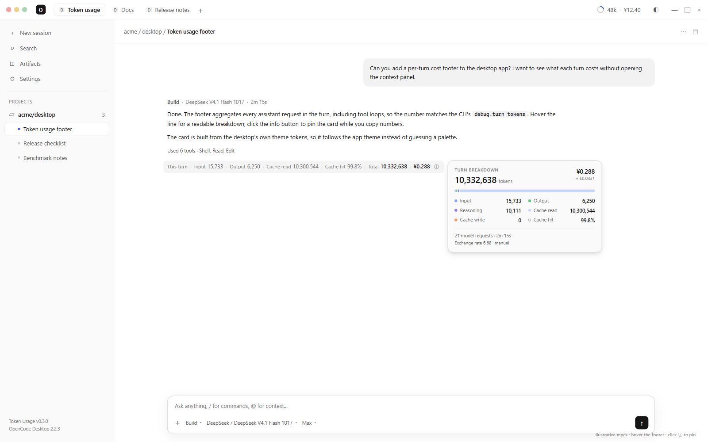

<div align="center">

# OpenCode Token Usage

**每一轮到底花了多少，直接写在回复下面。**

给 **OpenCode Desktop** 的零配置 GUI 插件：按轮统计 token、缓存命中率和人民币费用。

[](https://github.com/AquariusCZ/opencode-token-usage-gui/actions/workflows/ci.yml)
[](LICENSE)
[](https://opencode.ai/)
[](https://github.com/AquariusCZ/opencode-token-usage-gui/issues)

[安装](#安装) · [功能](#功能) · [配置](#配置) · [实现](#实现方式) · [常见问题](#常见问题) · [English](README.md)

</div>



*英文示意图，非真实会话截图。*

> OpenCode Desktop 右上角显示的是「最近一次请求」和「整个会话累计」。
> 它不回答「这一轮花了多少」。这个插件补的就是这一行。

## 10 秒版

```text
本轮  输入 15,733 · 输出 6,250 · 缓存读 10,300,544 · 缓存命中 99.8% · 合计 10,332,638 · ¥0.288
```

鼠标悬停可以看到完整明细：

```text
本轮 10,332,638 词元 · ¥0.288 ($0.0431)
输入 15,733 · 输出 6,250 · 推理 10,111
缓存读 10,300,544 · 缓存写 0 · 缓存命中 99.8%
21 次模型请求 · 2m 15s
```

## 为什么不直接用右上角的上下文面板？

上下文面板回答的是**「现在上下文有多大」**；这个插件回答的是**「这一轮花了多少、钱花在哪」**。

| | 内置上下文面板 | 这个插件 | CLI `debug.turn_tokens` |
| --- | :---: | :---: | :---: |
| 最近一次请求 | ✅ | ❌（按轮） | — |
| 整轮合计 | ❌ | ✅ | ✅ |
| 缓存命中率 | ❌ | ✅ | — |
| 每轮费用 | ❌ | ✅ 人民币 / 美元 | ❌ |
| 每条回复下方常驻 | ❌ | ✅ | ✅ |
| 桌面 GUI 可用 | ✅ | ✅ | ❌ |

一轮不是一次请求。长任务里可能有 20 多次 assistant 请求和工具调用；只看最后一条 assistant 消息，会严重低估
这一轮的真实消耗。插件把整轮加总，再挑出真正影响账单的几个数。

## 功能

- **按轮统计，不是按单条消息。** 一轮一个 footer，汇总所有 assistant 请求和工具循环。
- **实时计数。** 默认 `continuous` 模式：会话运行时每 100ms 采样，60Hz 一阶滞后持续追目标，新采样只改目标、不重置动画，所以从第一个 token 到最终合计是一段连续运动；`interval` 模式保留原来的离散刷新 + tween。尊重 `prefers-reduced-motion`。
- **缓存感知。** 显示缓存读和缓存命中率——DeepSeek / Anthropic 的费用差异主要在这里。
- **默认人民币。** 支持手动汇率或每日缓存汇率，原始美元放在 tooltip；`"currency": "USD"` 切回美元，`"auto"` 跟随界面语言。
- **撤销感知。** 被 revert / undo 边界隐藏的消息不会计入。
- **中英双语。** 跟随应用语言自动切换。
- **紧凑 / 详细。** 默认只显示决策相关的数；`detailed` 会把推理 token 和缓存写也放到可见行。
- **零运行时依赖。** 一个构建好的 CJS 文件；默认不联网、没有遥测、不读 API Key（只有手动开启 `usdToCny: "auto"` 才会每天请求一次汇率）。
- **安静失败。** OpenCode 更新导致内部 DOM 变化时，插件只打印一次警告，不会破坏时间线。
- **快。** 2,000 条消息的聚合在测试里约 3ms；continuous 模式 100ms 采样 + 60Hz 滤波，interval 模式用 `refreshMs` 定时器，另有防抖 `MutationObserver`。

## 安装

### 30 秒版（GitHub）

```sh
opencode plugin add github:AquariusCZ/opencode-token-usage-gui
```

然后在桌面端按 `Ctrl/Cmd + R` 重载，或者重启服务：

```sh
opencode service restart
```

### 手动安装

```sh
git clone https://github.com/AquariusCZ/opencode-token-usage-gui.git \
  ~/.config/opencode/plugins/opencode-token-usage-gui
```

Windows PowerShell：

```powershell
git clone https://github.com/AquariusCZ/opencode-token-usage-gui.git `
  "$env:USERPROFILE\.config\opencode\plugins\opencode-token-usage-gui"
```

OpenCode 会自动发现 `~/.config/opencode/plugins/` 下的插件目录。如果 footer 没出现，打开
**设置 → 扩展 → 插件** 点 **Reload**，或执行 `opencode service restart`。

### 确认安装成功

1. 每一轮完成或生成中的消息下方出现 footer。
2. **设置 → 扩展 → 插件** 里有 `token-usage-gui`，开关是开的。
3. `opencode plugin list` 能看到 `token-usage-gui`。
4. 有问题就看 `~/.local/share/opencode/log/opencode.log` 里有没有 `token-usage-gui`。

### 卸载

删掉目录并重载。只想关桌面 UI：在 **设置 → 扩展 → 插件** 里关掉开关。包安装可以用：

```sh
opencode plugin remove opencode-token-usage-gui
```

## 配置

在 `opencode.json(c)` 的插件条目里传 options：

```jsonc
{
  "plugins": [
    {
      "package": "opencode-token-usage-gui",
      "options": {
        "compact": false,
        "detailed": false,
        "showCost": true,
        "animate": true,
        "refreshMode": "continuous",
        "sampleMs": 100,
        "smoothMs": 250,
        "refreshMs": 500,
        "tweenMs": 550,
        "currency": "CNY",
        "usdToCny": 6.68
      }
    }
  ]
}
```

| 选项 | 默认值 | 说明 |
| --- | --- | --- |
| `compact` | `false` | 只显示输入、输出、合计、费用。 |
| `detailed` | `false` | 在可见行里额外显示推理 token 和缓存写。 |
| `showCost` | `true` | 显示每轮费用。 |
| `animate` | `true` | 是否动画；`false` 两种模式都直接跳。 |
| `refreshMode` | `"continuous"` | `"continuous"`（连续计数）或 `"interval"`（间隔刷新 + tween）。 |
| `sampleMs` | `100` | continuous 模式运行中的采样间隔，50–1000ms；空闲时 1000ms。 |
| `smoothMs` | `250` | continuous 模式的一阶滞后时间常数，50–2000ms；越大越柔和/越慢。 |
| `refreshMs` | `500` | 仅 interval 模式：刷新间隔，16–5000ms。 |
| `tweenMs` | `550` | 仅 interval 模式：tween 时长，0–2000ms。 |
| `currency` | `"CNY"` | `"CNY"`、`"USD"` 或 `"auto"`；`auto` 在中文界面用人民币，其他语言用美元。 |
| `usdToCny` | `6.68` | 数字表示手动汇率（不联网）；`"auto"` 表示每日自动汇率（见下）。 |

本地目录也可以用同样的方式配置：

```jsonc
{
  "plugins": [
    {
      "package": "./plugins/opencode-token-usage-gui",
      "options": { "compact": true }
    }
  ]
}
```

### 货币与汇率

应用上报的 `message.cost` 永远是美元；人民币只是**显示换算**，不是第二套计费。

- `currency: "CNY"`（默认）显示 `¥`。
- `currency: "USD"` 显示应用原始的 `$`。
- `currency: "auto"`：中文界面用人民币，其他语言用美元。
- `usdToCny: 6.68` 是手动汇率，**不联网**，结果确定。
- `usdToCny: "auto"` 每天从 `open.er-api.com` 拉一次 USD→CNY，缓存 24 小时；失败时用上次缓存或 `6.68` 兜底。只有这个显式选项会联网。

tooltip 会明确告诉你用的是哪种汇率：

```text
汇率 6.68 · 手动
汇率 6.72 · 自动 (2026-10-30)
汇率 6.68 · 兜底
```

想让数字和账单完全一致，就把 `usdToCny` 改成你自己的计费汇率。

### 刷新模式

`refreshMode` 就是开关：

- **`"continuous"`（默认）**：会话运行时每 `sampleMs`（100ms）读一次 store，空闲时每 1000ms 读一次；画面
  60Hz 用一阶滞后（`smoothMs`，250ms）追最新目标。新采样只改变目标，不重置动画，所以从第一个 token 到
  最终合计看起来是一段连续运动。
- **`"interval"`**：原来的行为，每 `refreshMs`（500ms）读一次，再用 `tweenMs`（550ms）补间。适合喜欢明显
  分段或固定采样节奏的人。

`animate: false` 两种模式都直接跳到目标值。

为什么这样拆：屏幕可以 60Hz 更新，但数据只会在会话 store 变化时变；60Hz 轮询 store 很浪费（见下）。
100ms 采样 + 60Hz 滤波，用更低 CPU 得到同样的连续感。

在 Windows 11、约 200 条消息的会话上实测：`interval` 500ms 约占单核 **1.6%**，continuous（100ms 采样）
约占 **2.7%**，16.67ms（60Hz）轮询约占 **12.7%**（20 秒 `Get-Process` CPU 时间）。continuous 模式保持 60Hz
动画但 100ms 采样，避免 60Hz 轮询成本。

窗口隐藏时采样暂停，重新可见时立即刷新一次；应用重渲染时间线时，防抖的 `MutationObserver` 会把 footer
挂回去。

### 显示模式

| 模式 | 可见行 |
| --- | --- |
| 默认 | 输入 · 输出 · 缓存读 · 缓存命中 · 合计 · 费用 |
| `compact: true` | 输入 · 输出 · 合计 · 费用 |
| `detailed: true` | 输入 · 输出 · 推理 · 缓存读 · 缓存写 · 缓存命中 · 合计 · 费用 |

tooltip 永远显示完整明细，包括请求次数和耗时。

## 数字口径

合计和 OpenCode 自己的口径一致：

```text
input + output + reasoning + cache.read + cache.write
```

- **一轮**：从一条 user 或 synthetic 消息开始，到下一条 user/synthetic 之前，包含中间所有 assistant 请求。
- **缓存命中率**：`cache.read / (input + cache.read + cache.write)`，表示 prompt 里有多大比例来自缓存。
- **费用**：来自应用上报的每请求 `message.cost`（美元）。人民币只是显示换算，不是第二套计费。
- **请求次数**：有 usage 记录的 assistant 消息数，不是工具调用次数。
- **耗时**：这一轮第一条 assistant 请求到最后一条完成的时间。

如果模型/供应商没有上报费用（免费模型、部分本地 provider），费用会隐藏，token 仍然显示。

## 实现方式

```text
user message
   │
   ├─ assistant request 1 ─┐
   ├─ tool call            │
   ├─ assistant request 2  ├─ 一轮
   ├─ tool call            │
   └─ assistant request 3 ─┘
                │
                ▼
   input + output + reasoning + cache.read + cache.write
```

1. 从应用的客户端 store 读取当前会话的消息列表；
2. 按前面的 user/synthetic 消息把 assistant 消息分组，累加 `tokens` 和 `cost`；
3. 找到渲染出来的 assistant 内容容器（`[data-slot="session-turn-assistant-content"]`），把 footer 节点挂进去；
4. 500ms 定时刷新；`MutationObserver` 在应用重渲染时把 footer 挂回去；`requestAnimationFrame` 做数字动画。

GUI 插件 API 目前没有官方的「消息底部插槽」，所以最后一步是 DOM 注入。这是整个插件最脆的地方：未来
OpenCode 如果改了 slot 名，footer 会消失（插件只打印一次警告），不会污染时间线。选择器和聚合逻辑分别隔离在
`src/gui.cjs` 和 `src/core.cjs`，适配通常只需要改一行选择器。

## 兼容性

- 在 **OpenCode Desktop 2.2.3** + Windows 11 上验证。
- 需要 V2 桌面端；终端 TUI 不适用。
- OpenCode 官方把 GUI 插件 API 标为 experimental，后续版本可能有变化。
- 基于 DOM 的实现理论上 macOS / Linux 也能用，但这两个平台没有实测。

终端里请继续用 CLI 的 `debug.turn_tokens`，或者装 TUI 专用的 token 插件。

## 隐私

- 默认不联网、没有遥测、不读取 API Key。
- 只读桌面端内存里已经存在的本地会话状态。
- 默认汇率是手动常量，不会在运行时请求汇率接口。
- `usdToCny: "auto"` 是唯一的联网路径：每天一次 `open.er-api.com`，缓存 24 小时。想完全离线就保持手动汇率。

## 常见问题

**会把我的 prompt 或会话数据发到哪里吗？**
不会。插件里没有网络代码。

**为什么按轮，不按每条消息？**
一轮里可能有很多 assistant 请求和工具循环；按单条消息显示会漏掉大部分消耗。想要更多指标可以开 `detailed`。

**能看到推理 token 吗？**
可以：`detailed: true`，或者直接把鼠标悬停在 footer 上。推理 token 永远在 tooltip 里。

**能用美元吗？**
可以：`"currency": "USD"`。

**为什么费用是 0？**
该请求没有上报 cost。免费模型和部分本地 provider 会这样，token 统计不受影响。

**OpenCode 升级后还能用吗？**
通常可以；最脆的是选择器。升级后 footer 消失的话，带上 OpenCode 版本和截图开 issue。

**汇率是怎么定的？**
默认用手动 `usdToCny`（`6.68`）。设成 `"usdToCny": "auto"` 会每天拉一次汇率、缓存 24 小时；失败时用上次缓存或 `6.68` 兜底。tooltip 会显示汇率、来源和自动更新的日期。

**刷新频率能调吗？**
可以。`refreshMode: "continuous"` 用 `sampleMs`（50–1000，默认 100）和 `smoothMs`（50–2000，默认 250）；`refreshMode: "interval"` 用 `refreshMs`（16–5000，默认 500）和 `tweenMs`（0–2000，默认 550）。窗口隐藏时暂停采样，重新可见时立即刷新。

**TUI 能用吗？**
不能。TUI 用 `debug.turn_tokens`；这个插件是给桌面 GUI 的。

## Roadmap

- 按单条 assistant 消息显示的模式。
- tooltip 里显示上下文使用率。
- 导出每轮 usage 为 CSV/JSON。
- 按供应商维护价格表，替代单一的 USD→CNY 汇率。
- 用设置面板代替 JSON options。
- 选择器健康检查：DOM 变化时主动报告。

有想法或 PR 都欢迎。如果这个插件帮你省了一次滚动，点个 star 能让更多人找到它。

## 开发

```sh
npm install
npm test        # 纯逻辑测试，Node 内置 test runner
npm run build   # src/gui.cjs -> dist/gui-experimental.cjs
npm run check   # build + test
```

目录：

```text
src/core.cjs              纯聚合 / 格式化逻辑
src/gui.cjs               插件生命周期、DOM、动画
dist/gui-experimental.cjs 构建后的单文件 CJS（已提交）
test/core.test.cjs        单元测试
scripts/build.mjs         esbuild 打包
```

本地开发时，每次 build 后把 `dist/gui-experimental.cjs` 复制到插件目录，或者直接把插件指向仓库目录再重载。
应用会监听构建产物并重载 GUI。

## 参与贡献

- bug、选择器失效、功能建议都可以开 issue。
- 改完 `src/` 记得重新 build；CI 会检查 `dist` 是否同步。
- 提 PR 前跑一遍 `npm test`。
- 如果是 OpenCode 升级导致 footer 消失，请带上版本号和截图。

## License

MIT © [AquariusCZ](https://github.com/AquariusCZ)

---

[English README](README.md)
